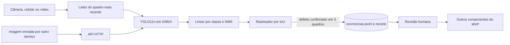

# Via Atenta: componente de visão

Detector de buracos e rachaduras em tempo real, feito para a Global Solution 2026.2 (CitizenTech) da FIAP, disciplina Applied Computer Vision. Ele usa um YOLO11n treinado com a base pública RDD2022 e roda em CPU comum, sem placa de vídeo, a partir de webcam, celular ou vídeo.

- Relatório: [docs/relatorio_via_atenta.pdf](docs/relatorio_via_atenta.pdf)
- Vídeo de demonstração: `[link do vídeo]`
- Roteiro do vídeo: [docs/roteiro_video.md](docs/roteiro_video.md)

## Integrantes

| Nome | RM |
|---|---|
| Breno Silva | RM97864 |
| Enrico Marquez | RM99325 |
| Gustavo Dias | RM550820 |
| Joel Barros | RM550378 |
| Leonardo Moreira | RM550988 |

## Ficha Técnica do MVP

| Campo | Conteúdo |
|---|---|
| Nome do produto | Via Atenta |
| Cidadão e território | Quem circula pelas vias urbanas (motociclistas, ciclistas, passageiros de ônibus, pedestres com mobilidade reduzida) e as equipes de zeladoria, começando por São Paulo |
| Problema, em uma frase | Defeitos no pavimento muitas vezes só entram na fila de conserto depois que alguém reclama: foram quase 52 mil pedidos de tapa-buraco em São Paulo no primeiro semestre de 2026 |
| Proposta de valor | Câmeras comuns encontram buracos e rachaduras enquanto o veículo circula, e cada achado chega à revisão humana como dado estruturado |
| Arquitetura: componentes | Visão (este repositório). Os outros componentes são definidos pela equipe |
| Fontes de dados | RDD2022 (imagens de Índia, Japão e República Tcheca), obtido por dois espelhos públicos no Hugging Face |
| Modelos de IA utilizados | YOLO11n com ajuste fino, duas classes (buraco, rachadura) |
| URL do MVP e repositório | `[URL do MVP]`, `[link deste repositório]` |
| Indicadores de impacto | Defeitos confirmados por quilômetro percorrido, tempo até o defeito entrar na fila e fração das sugestões aprovadas na revisão humana |
| ODS conectados | ODS 11 (cidades e comunidades sustentáveis) e ODS 9 (indústria, inovação e infraestrutura) |

## Resultados

<!-- RESULTADOS:INICIO -->
mAP50 no teste: **0.504**. mAP50-95: **0.221**.

| Classe | Instâncias | AP50 | Limiar | Precisão | Revocação |
|---|---:|---:|---:|---:|---:|
| buraco | 578 | 0.535 | 0.28 | 0.631 | 0.471 |
| rachadura | 781 | 0.474 | 0.20 | 0.501 | 0.503 |

Velocidade do aplicativo em CPU do Colab: 104 ms por quadro (9.6 FPS).
<!-- RESULTADOS:FIM -->

## Como funciona



## Como rodar

Precisa de Python 3.10 ou mais novo.

```powershell
# Windows
python -m venv .venv
.venv\Scripts\activate
pip install -r requirements.txt
```

```bash
# Linux e macOS
python3 -m venv .venv
source .venv/bin/activate
pip install -r requirements.txt
```

O modelo treinado já está em `modelos/via_atenta.onnx`, com os limiares em `modelos/limiares.json`.

```bash
python -m via_atenta.detectar --fonte 0                                # webcam
python -m via_atenta.detectar --fonte docs/demo/demo_rdd2022.mp4       # vídeo incluído no repositório
python -m via_atenta.detectar --fonte rua.mp4 --salvar-video           # grava o vídeo anotado
python -m via_atenta.detectar --fonte fotos/                           # pasta de imagens
python -m via_atenta.detectar --fonte http://192.168.0.10:8080/video   # celular como câmera
```

Aperte `Q` para sair. A saída fica em `saida/`:

- `ocorrencias.jsonl`: um defeito por linha
- `recortes/`: a imagem de cada defeito
- `desempenho.json`: FPS e latência da execução

Em vídeo gravado de dentro do carro, `--ignorar-topo 0.3` descarta detecções na parte de cima do quadro, onde ficam céu e fachadas. Para usar o celular como câmera, um aplicativo como o IP Webcam (Android) mostra a URL do vídeo. Celular e computador precisam estar na mesma rede.

## Reproduzir o treino

1. Abra [notebooks/treino_via_atenta_colab.ipynb](notebooks/treino_via_atenta_colab.ipynb) no Google Colab.
2. Use **Ambiente de execução > Executar tudo**, com GPU T4.
3. Baixe o `resultados.zip` no fim.
4. Rode `python ferramentas/incorporar_resultados.py resultados.zip`.

O passo 4 copia o modelo, roda o aplicativo nas amostras do teste, atualiza esta página e refaz o relatório. A semente, a versão do Ultralytics (8.4.200) e a divisão dos dados são fixas. Mesmo assim, a GPU pode gerar pequenas diferenças entre execuções.

O notebook embute `via_atenta/preparar_dados.py` e `via_atenta/detector.py`. Se mudar um deles, rode `python ferramentas/gerar_notebook.py`.

## Integração com o MVP

O contrato completo está em [docs/contrato_ocorrencias.md](docs/contrato_ocorrencias.md). Existem dois caminhos:

```bash
# 1. Ler ocorrencias.jsonl, gerado pelo detector
# 2. Chamar a API
python -m via_atenta.api --porta 8000
curl -F imagem=@rua.jpg http://127.0.0.1:8000/v1/deteccoes
```

## Privacidade e IA responsável

- Por padrão, só o recorte do defeito é salvo, nunca o quadro inteiro. O vídeo anotado só existe com `--salvar-video`, e o programa avisa que ele pode conter rostos e placas.
- A API processa a imagem em memória e não grava nada.
- A localização é opcional e só entra se for informada.
- Toda ocorrência nasce como `pendente_revisao`. O modelo sugere e uma pessoa decide.
- O desempenho é medido por país para expor viés. A base não tem imagens brasileiras, então nada aqui garante o mesmo resultado nas ruas do Brasil.

## Testes

```bash
pip install -r requirements-dev.txt
pytest
```

Os testes que usam um modelo real ficam pulados sem os arquivos. Para rodá-los, baixe `yolo11n.onnx` e o `coco128` para uma pasta e defina `VIA_ATIVOS` com o caminho dela. `ferramentas/ensaiar_notebook.py` executa as células do notebook sem GPU, com um treino simulado.

## Estrutura

```text
via_atenta/    aplicativo: detector, rastreador, ocorrências, API e preparo dos dados
notebooks/     treino no Google Colab
ferramentas/   geração do notebook e do relatório, ensaio e incorporação dos resultados
tests/         testes automatizados
modelos/       modelo ONNX, pesos e limiares
resultados/    métricas, gráficos e exemplos
docs/          relatório, roteiro do vídeo, contrato de integração
```

## Base de dados e licenças

- Imagens: RDD2022, de Arya et al., [arXiv:2209.08538](https://arxiv.org/abs/2209.08538), licença CC BY-SA 4.0. Lista oficial de downloads em [sekilab/RoadDamageDetector](https://github.com/sekilab/RoadDamageDetector).
- Origem dos arquivos: os endereços oficiais responderam 403 ao Colab em 04/11/2026. Imagens e trincas (D00, D10, D20) vêm de [dronefreak/RDD2022](https://huggingface.co/datasets/dronefreak/RDD2022), revisão `72b01f94`. Buracos (D40) vêm de [edwrdc/RDD2022](https://huggingface.co/datasets/edwrdc/RDD2022), revisão `d8967222`. A classe 3 do primeiro espelho, chamada pothole, marca faixas e sinalização, por isso foi descartada. Só entram imagens presentes nos dois espelhos.
- Treino: [Ultralytics YOLO](https://github.com/ultralytics/ultralytics), AGPL-3.0. Por usar esses pesos como ponto de partida, este repositório também é AGPL-3.0.
