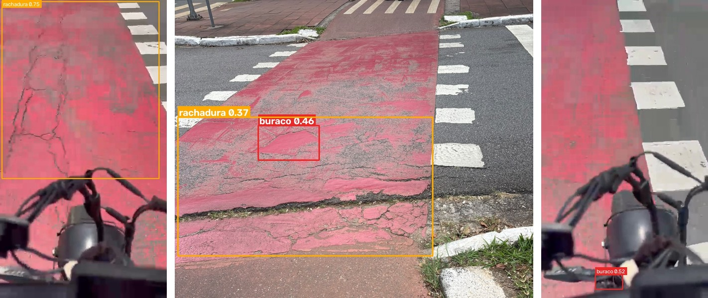
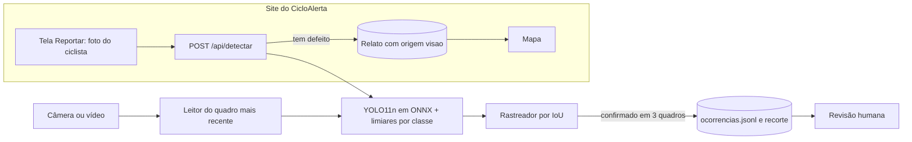

# CicloAlerta: componente de visão

Detector de buracos e rachaduras feito para a Global Solution 2026.2 (CitizenTech) da FIAP, disciplina Applied Computer Vision. Ele usa um YOLO11n treinado pela equipe com a base pública RDD2022 e roda em CPU comum, sem placa de vídeo.

No CicloAlerta, ele trabalha de dois jeitos:

- **Na tela Reportar do site:** o ciclista manda a foto de um buraco, a rota `POST /api/detectar` confirma se há defeito e o ponto vai para o mapa.
- **Em tempo real:** o detector analisa o vídeo de uma câmera (webcam, celular ou vídeo gravado), desenha as caixas e registra cada defeito confirmado.

Links:

- Relatório: [docs/relatorio_cicloalerta.pdf](docs/relatorio_cicloalerta.pdf)
- Vídeo de demonstração: https://youtu.be/fcH5B_v2BaU
- Integração com o site: [docs/integracao_site.md](docs/integracao_site.md)

## Integrantes

| Nome | RM |
|---|---|
| Breno Silva | RM97864 |
| Enrico Marquez | RM99325 |
| Gustavo Dias | RM550820 |
| Joel Barros | RM550378 |
| Leonardo Moreira | RM550988 |

## Ficha Técnica do MVP

| Campo | Conteúdo |
|---|---|
| Nome do produto | CicloAlerta |
| Cidadão e território | Ciclistas e entregadores de bicicleta elétrica nas ciclovias da cidade de São Paulo |
| Problema, em uma frase | Buracos e desníveis nas ciclovias causam quedas, e na chuva ficam escondidos pela água |
| Proposta de valor | Saber antes de sair, e durante o trajeto, onde estão os trechos perigosos, com alerta mais forte em dia de chuva |
| Arquitetura: componentes | Site + API (FastAPI), detector de buracos (YOLO), assistente (LLM local com RAG), pipeline de dados (Airflow + Databricks), bot de triagem (Python), robô com sensor (ESP32), tudo publicado com Docker, Terraform e CI/CD |
| Fontes de dados | Open-Meteo (chuva), malha cicloviária do GeoSampa, relatos feitos no próprio MVP (com parte simulada e documentada) |
| Modelos de IA utilizados | YOLO treinado para buracos; LLM local pequeno via Ollama com busca em base de conhecimento |
| URL do MVP e repositório | `[URL do MVP]` · componente de visão: https://github.com/brenosrubio/cicloalerta-visao |
| Indicadores de impacto | Perigos mapeados, % de relatos confirmados, alertas enviados em dias de chuva, tempo até o perigo ser resolvido |
| ODS conectados | ODS 11 (cidades sustentáveis, transporte seguro), ODS 3 (saúde, menos acidentes de trânsito), ODS 9 (infraestrutura) |

## Resultados

<!-- RESULTADOS:INICIO -->
mAP50 no teste: **0.504**. mAP50-95: **0.221**.

| Classe | Instâncias | AP50 | Limiar | Precisão | Revocação |
|---|---:|---:|---:|---:|---:|
| buraco | 578 | 0.535 | 0.28 | 0.631 | 0.471 |
| rachadura | 781 | 0.474 | 0.20 | 0.501 | 0.503 |

Velocidade do aplicativo em CPU do Colab: 104 ms por quadro (9.6 FPS).
<!-- RESULTADOS:FIM -->

No computador da equipe, só com CPU, o detector em tempo real ficou entre 14 e 16 quadros por segundo.

**Fotos tiradas de perto.** A tela Reportar recebe fotos de alguém em pé ao lado do buraco, e o modelo aprendeu com câmera de carro. Para estimar o efeito, `ferramentas/testar_fotos_aproximadas.py` recorta um quadrado em volta de cada defeito marcado nas 60 amostras do teste:

| Defeitos encontrados | Foto inteira | Recorte médio | Recorte de perto |
|---|---:|---:|---:|
| Buraco (51) | 18 | 17 | 12 |
| Rachadura (63) | 34 | 27 | 19 |

O modelo perde defeitos quando a foto chega perto. O recorte ampliado fica mais borrado que uma foto real, então o número real deve ser um pouco melhor. Por isso o site deixa a pessoa enviar o relato mesmo quando o modelo não encontra nada.

**Fotos de celular, com e sem água.** Para medir o cenário de chuva, o modelo rodou nas 713 fotos de celular da base de Kent (Dib, Sirlantzis e Howells, 2023), que ele nunca viu. São buracos fotografados de perto no Reino Unido, muitos cheios de água. As 200 fotos da partição de teste foram separadas à mão em "com água" e "seco" (`resultados/kent_agua.json`). Rode com `python ferramentas/testar_kent.py pasta_da_base`.

| Fotos de Kent | Fotos | Buracos marcados | AP50 | Revocação no limiar | Fotos em que aponta buraco |
|---|---:|---:|---:|---:|---:|
| Teste, secas | 141 | 185 | 0,42 | 0,44 | 77% |
| Teste, com água | 56 | 107 | 0,31 | 0,28 | 61% |
| Todas as 713 | 713 | 1.153 | 0,30 | 0,31 | 65% |

Com água, o modelo acha menos buracos, e os buracos grandes cheios de água fotografados de perto são os que ele mais perde. Isso confirma o problema que o CicloAlerta quer tratar e diz qual deve ser o próximo treino. Três fotos do teste ficaram de fora da separação porque não dava para dizer se estavam molhadas. Parte das caixas da base está deslocada, então esses números tendem a subestimar o modelo.

**Numa ciclovia de São Paulo.** A equipe gravou 39 segundos de uma ciclovia paulistana com o celular preso ao guidão. O vídeo foi convertido de 60 para 15 quadros por segundo e passou pelo detector a 14,4 FPS, só na CPU. Não há marcação humana desse vídeo, então o teste é qualitativo (`resultados/teste_ciclovia.json`).



- A pintura trincada da ciclovia virou rachadura, com confiança de até 0,75 (à esquerda).
- Numa foto tirada de pé, sem o guidão, a API respondeu `tem_defeito: true`, com uma rachadura (0,37) sobre o trecho rachado e um buraco (0,46) onde a pintura soltou (no meio).
- O guidão no pé do quadro virou buraco com 0,52 (à direita). Com `--ignorar-base 0.3`, esse erro some. Das 35 ocorrências registradas, parte são linhas transversais do piso, que podem ser trincas ou juntas, e só a revisão humana decide.
- Dois defeitos ficaram sem registro: uma borda quebrada entre a faixa e o concreto, marcada como buraco com até 0,46 em só 2 quadros (o detector exige 3), e o vão de uma travessia, que não passou de 0,19. São degraus e emendas, diferentes dos buracos de asfalto da RDD2022. Baixar o limiar de buraco para 0,15 registrou a borda, mas também o guidão e o painel, e levou os buracos registrados em outros quatro vídeos da equipe de 28 para 69, quase todos sem buraco real. Mantivemos o limiar calibrado.

## Como funciona



## Como rodar

Precisa de Python 3.10 ou mais novo.

```powershell
# Windows
python -m venv .venv
.venv\Scripts\python -m pip install -r requirements.txt
```

```bash
# Linux e macOS
python3 -m venv .venv
source .venv/bin/activate
pip install -r requirements.txt
```

O modelo treinado já está em `modelos/cicloalerta.onnx`, com os limiares em `modelos/limiares.json`.

### Em tempo real

```bash
python -m cicloalerta.detectar --fonte 0                                # webcam
python -m cicloalerta.detectar --fonte docs/demo/demo_rdd2022.mp4       # vídeo incluído no repositório
python -m cicloalerta.detectar --fonte docs/demo/ciclovia.mp4 --ignorar-base 0.3   # ciclovia de São Paulo, o vídeo da demonstração
python -m cicloalerta.detectar --fonte rua.mp4 --salvar-video           # grava o vídeo anotado
python -m cicloalerta.detectar --fonte fotos/                           # pasta de imagens
python -m cicloalerta.detectar --fonte http://192.168.0.10:8080/video   # celular como câmera
```

No Windows, troque `python` por `.venv\Scripts\python`. Para sair, clique na janela do vídeo e aperte `Q` ou `Esc`, ou feche a janela no X. A saída fica em `saida/`:

- `ocorrencias.jsonl`: um defeito por linha
- `recortes/`: a imagem de cada defeito
- `desempenho.json`: FPS e latência da execução

Em vídeo gravado de dentro de um veículo, `--ignorar-topo 0.3` descarta detecções na parte de cima do quadro, onde ficam céu e fachadas. Com o celular preso ao guidão da bicicleta, `--ignorar-base 0.3` descarta a parte de baixo, onde aparecem o guidão e a roda:

```bash
python -m cicloalerta.detectar --fonte docs/demo/ciclovia.mp4 --ignorar-base 0.3
```

O `docs/demo/ciclovia.mp4` tem os primeiros 23 segundos do vídeo que a equipe gravou, já em 15 quadros por segundo. É o trecho usado na demonstração.

Gravações de celular costumam ter 60 quadros por segundo. Sem placa de vídeo, o detector processa uns 15 por segundo, então o vídeo parece lento. Para ver em velocidade real, converta antes com `ffmpeg -i original.mp4 -vf fps=15 -an ciclovia.mp4`.

Para usar o celular como câmera, um aplicativo como o IP Webcam (Android) mostra a URL do vídeo. Celular e computador precisam estar na mesma rede.

### API da tela Reportar

```bash
python -m cicloalerta.api --porta 8000
curl -F imagem=@docs/demo/foto_ciclovia.jpg http://127.0.0.1:8000/api/detectar
```

No Windows, use `curl.exe`. A foto de exemplo é da ciclovia que a equipe gravou, e a resposta traz `tem_defeito: true`, uma rachadura e um buraco, os dois com severidade sugerida `media`.

A resposta e as regras estão em [docs/contrato_ocorrencias.md](docs/contrato_ocorrencias.md). Quem cuida do site encontra a rota pronta para o FastAPI em [docs/integracao_site.md](docs/integracao_site.md).

## Reproduzir o treino

1. Abra [notebooks/treino_cicloalerta_colab.ipynb](notebooks/treino_cicloalerta_colab.ipynb) no Google Colab.
2. Use **Ambiente de execução > Executar tudo**, com GPU T4.
3. Baixe o `resultados.zip` no fim.
4. Rode `python ferramentas/incorporar_resultados.py resultados.zip`.

O passo 4 copia o modelo, roda o aplicativo nas amostras do teste, atualiza esta página e refaz o relatório. A semente, a versão do Ultralytics (8.4.200) e a divisão dos dados são fixas. Mesmo assim, a GPU pode gerar pequenas diferenças entre execuções.

O notebook embute `cicloalerta/preparar_dados.py` e `cicloalerta/detector.py`. Se mudar um deles, rode `python ferramentas/gerar_notebook.py`. O treino foi feito quando o projeto ainda tinha o nome provisório Via Atenta, por isso esse nome aparece nos metadados do modelo.

## Privacidade e IA responsável

- Por padrão, só o recorte do defeito é salvo, nunca o quadro inteiro. O vídeo anotado só existe com `--salvar-video`, e o programa avisa que ele pode conter rostos e placas.
- A API processa a foto em memória e não grava nada. Se o site guardar a foto, ele apaga os metadados (EXIF) antes.
- A localização é opcional e só registra o ponto do defeito, nunca o trajeto de quem pedala.
- Toda ocorrência nasce como `pendente_revisao`. O modelo sugere e uma pessoa decide.
- O desempenho é medido por país para expor viés. A base não tem imagens brasileiras nem de ciclovias, então nada aqui garante o mesmo resultado nas ciclovias de São Paulo.

## Limites conhecidos

- O treino usa ruas da Índia, do Japão e da República Tcheca vistas de dentro do carro. Não há fotos de ciclovias nem do Brasil. A única base pública de defeitos em ciclovias que encontramos, o BLDD (Barcelona), publicou só as marcações, sem as imagens. O teste na ciclovia de São Paulo é qualitativo, sem marcação humana.
- O modelo perde defeitos em fotos tiradas de perto e acha menos buracos quando eles estão cheios de água (tabelas acima).
- Marcas de pneu, faixas pintadas e tampas de bueiro às vezes viram falso positivo. Com a câmera no guidão, o próprio guidão vira buraco se `--ignorar-base` não for usado.
- O próximo passo é um ajuste fino com fotos de celular de buracos com água, como as de Kent, e depois com as fotos que chegarem pela tela Reportar, já revisadas. O ajuste com Kent não foi feito porque o Colab ficou sem GPU disponível no prazo.

## Testes

```bash
pip install -r requirements-dev.txt
pytest
```

Os testes que usam um modelo real ficam pulados sem os arquivos. Para rodá-los, baixe `yolo11n.onnx` e o `coco128` para uma pasta e defina `CICLOALERTA_ATIVOS` com o caminho dela. `ferramentas/ensaiar_notebook.py` executa as células do notebook sem GPU, com um treino simulado.

## Estrutura

```text
cicloalerta/   aplicativo: detector, rastreador, ocorrências, API e preparo dos dados
notebooks/     treino no Google Colab
ferramentas/   notebook, relatório, ensaio, incorporação dos resultados e testes de fotos aproximadas e com água
tests/         testes automatizados
modelos/       modelo ONNX, pesos e limiares
resultados/    métricas, gráficos e exemplos
docs/          relatório, integração com o site, contrato e roteiro do vídeo
```

## Base de dados e licenças

- Imagens: RDD2022, de Arya et al., [arXiv:2209.08538](https://arxiv.org/abs/2209.08538), licença CC BY-SA 4.0. Lista oficial de downloads em [sekilab/RoadDamageDetector](https://github.com/sekilab/RoadDamageDetector).
- Origem dos arquivos: os endereços oficiais responderam 403 ao Colab em 04/11/2026. Imagens e trincas (D00, D10, D20) vêm de [dronefreak/RDD2022](https://huggingface.co/datasets/dronefreak/RDD2022), revisão `72b01f94`. Buracos (D40) vêm de [edwrdc/RDD2022](https://huggingface.co/datasets/edwrdc/RDD2022), revisão `d8967222`. A classe 3 do primeiro espelho, chamada pothole, marca faixas e sinalização, por isso foi descartada. Só entram imagens presentes nos dois espelhos.
- Teste com água: base de Kent, de Dib, Sirlantzis e Howells, *Data in Brief* 48, 109206 (2023), [Mendeley Data 10.17632/tp95cdvgm8.1](https://data.mendeley.com/datasets/tp95cdvgm8/1), licença CC BY 4.0. As fotos não estão no repositório.
- Treino: [Ultralytics YOLO](https://github.com/ultralytics/ultralytics), AGPL-3.0. Por usar esses pesos como ponto de partida, este repositório também é AGPL-3.0.
